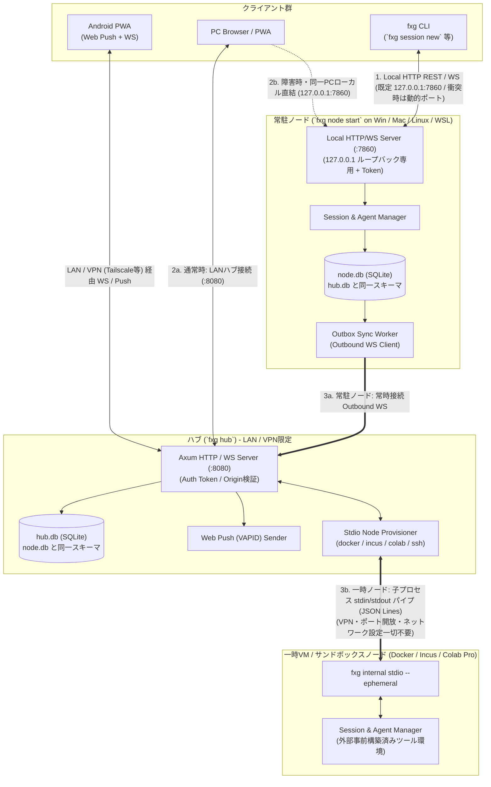
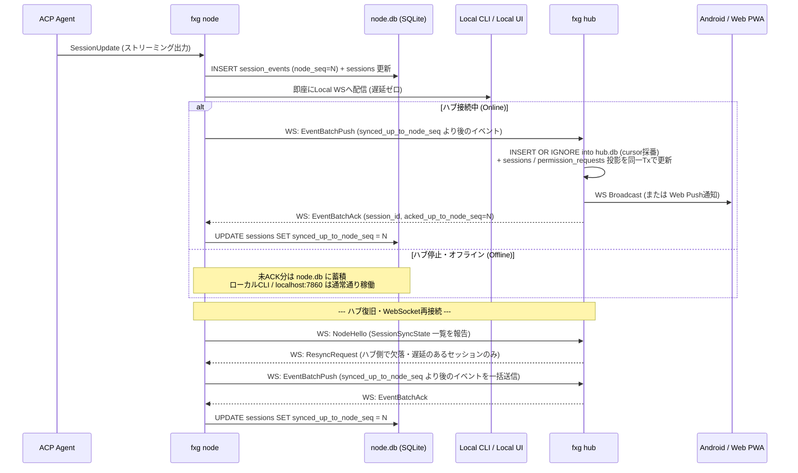
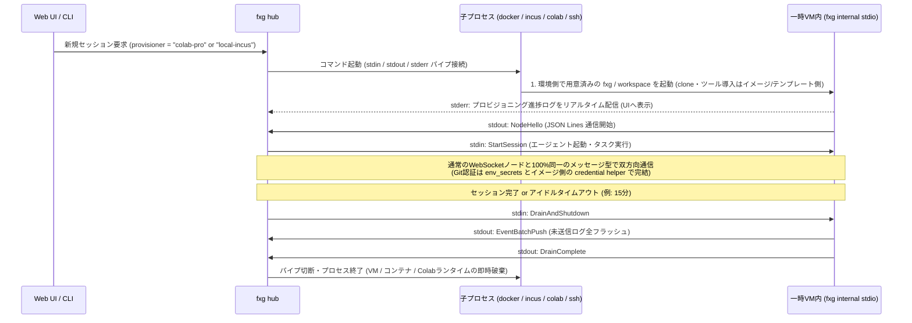

# 01. 全体アーキテクチャ・同期モデル・一時VM・プロジェクト解決

本ドキュメントでは、FlexAgent (`fxg`)
の通信トポロジー、ハブ停止時にも機能するローカルファースト同期（Store-and-Forward）、ネットワーク非依存の一時VM・サンドボックスノード（`fxg internal stdio`）、および異なるPC・OS間で同じプロジェクトとして認識する仕組みを定義します。

---

## 1. システムトポロジーとコンポーネントの責務



> ローカル HTTP/WS の待受は既定で `127.0.0.1:7860`。7860 が使用中で
> `--listen` / `[node] listen_addr` が明示されていない場合のみ、`127.0.0.1:0`
> （ephemeral port）へフォールバックし、実際のアドレスを `node.addr` に書き出す。
> CLI・`fxg web`・ブラウザのローカル直結はこのファイルを優先する。

### 各モードの起動方法（単一バイナリ `fxg`）

- **ハブ**: 自宅LAN内の常時稼働マシンやミニPC等で
  `fxg hub start --port 8080`
  を起動（LANまたはプライベートVPN内のみ公開し、パブリック露出は行わない）。
- **常駐ノード**: 各開発マシン（Windows, Mac, Linux, WSL）で
  `fxg node start` を常駐（デフォルトで `127.0.0.1:7860`
  のローカルループバックのみバインド）。
- **一時VM / サンドボックスノード**: ハブが Docker / Incus / Google
  Colab (`google-colab-cli`)
  等のコマンドを子プロセスとしてスポーンし、その標準入出力パイプ上で
  `fxg internal stdio --ephemeral` を直結起動（CLI の `--provisioner`
  もハブの API 経由で要求されるため、ハブ必須）。
- **CLI**: 開発者がターミナルで `fxg session new <agent>` を実行。

---

## 2. ローカルファースト & Store-and-Forward 同期プロトコル

ハブが単一障害点（SPOF）になることを防ぐため、**すべてのセッション状態とイベントの一次ソース（Primary
Source of Truth）は実行中のノード (`node.db`)** に置きます。ハブ
(`hub.db`) は全ノードの複製兼ルーティングハブとして機能します。

この構造は「**スキーマ1本・ログ1本・権威1つ**」の3原則で運用します
（スキーマ詳細は [`docs/02-database-schema.md`](./02-database-schema.md)）：

1. **スキーマは1本**: `node.db` と `hub.db` は同一DDL・同一テーブル名・単一の
   マイグレーションセットを共有し、違いは「行のスコープ」と「実行ロール」のみ。
   スキーマ対称性は規約ではなく単一定義で保証する。
2. **同期はイベントログ1本**:
   セッションのメタデータ（作成・タイトル・ステータス・モード）も
   `session_events` 上のイベントとして記録し、ハブの `sessions` /
   `permission_requests` はイベントから適用される**投影（projection）** とする。
   `SessionUpsert` のような別系統のメタデータ同期は行わない。
3. **書き込み権威は1つ**: セッション状態を書き換えられるのは**実行ノードのみ**。
   ハブはコマンド転送とイベント追記・投影適用のみを行い、セッション状態を
   クライアント要求に応じて直接書き換えない。

### 2.1 イベントID・順序・カーソルの設計

各セッション内で発生するイベント（メッセージ、思考チャンク、ツール呼び出し、権限要求など）は以下の識別子を持ちます：

- `event_id`: **UUID
  v7**（タイムスタンプ順序付きUUID。重複排除・冪等性保証に使用）
- `session_id`: **UUID v7**（セッション識別子）
- `node_seq`: **セッション単位の単調増加整数
  (`1, 2, 3...`)**。**実行ノードのみが採番**し、欠番は生じない。セッション内の論理順序は常にこの値を正とする。
- `cursor`: `session_events.cursor` (AUTOINCREMENT)
  が持つ**そのDBへの取り込み順の連番**。 クライアント（CLI / Web
  UI）の差分再開カーソルとして使用する。`node.db` を購読していれば `node.db` の
  cursor、`hub.db` を購読していれば `hub.db` の cursor が基準となる
  （**接続先ストア以外の cursor は意味を持たない**）。
- `created_at`: ノード側のローカル時計（Unix epoch
  ms）で記録。複数ノード横断の並び（承認Inbox等）は NTP
  同期された時計を前提とする。

「送信済み」の管理は行単位フラグではなく、**セッション単位の水位
`sessions.synced_up_to_node_seq`**（ハブが ACK した最大
`node_seq`）で表現します。 `node_seq`
は実行ノードだけが採番する欠番のない連番のため水位による表現が成立し、 Outbox
の抽出は `node_seq > synced_up_to_node_seq` の単純な述語、ACK 時の更新も O(1)
になります。

### 2.2 書き込みと同期のフロー (Outbox パターン)



### 2.3 ストリーミングチャンクの配信と永続化方針

思考過程やメッセージ生成のトークン単位チャンク（`AgentMessage`,
`AgentThought`）を1トークンずつSQLiteへ `INSERT`
するとディスクI/OとDBサイズが増大するため、`fxg node`
は「配信」と「永続化」を分離して処理します：

1. **メモリ上のリアルタイム配信（全チャンク）**:
   チャンクが到着した瞬間、メモリ上のブロードキャストチャネルを通じて Local
   WS（CLI・ローカルUI）およびハブWebSocket（`LiveStreamDelta`）へ**リアルタイム（遅延なし）**でそのまま流します。この経路はDBを経由しません。
2. **SQLiteへの永続化（ストリーム境界またはターン完了時）**:
   ストリーミング途中（`is_complete = false`）の中間状態は永続化しません。
   思考からメッセージへの切り替えや `message_id` / `thought_id` の変更など、
   **ストリームの境界**、またはターン完了時に、完成したイベント
   （`is_complete = true`）を `node_seq`
   を1つ消費した単一イベントとしてSQLite (`node.db` / `hub.db`)
   へ書き込みます。
   - ユーザーメッセージ (`UserMessage`)、ツール呼び出し
     (`ToolCall`)、権限要求/解決 (`PermissionRequest` /
     `PermissionResolved`)、状態変化 (`StatusChanged`)
     などの離散イベントは発生時に即時永続化します。
   - **トレードオフ**:
     クライアントがターン途中で切断した場合、未完了のメッセージ・思考は履歴に残りません（再接続後の履歴には完成済みイベントのみが表示されます）。`LiveStreamDelta`
     は再接続時にリプレイされません。

### 2.4 メタデータのイベントソーシングと投影（権威の一元化）

セッションのメタデータ（作成情報・タイトル・ステータス・モード/コマンド/設定）は専用の同期チャネルを持たず、
`session_events` 上のイベントとして記録します：

- `SessionCreated`（生成直後、`node_seq = 1`。プロジェクト・パス・エージェント・Fork元などを含む）
- `SessionTitleChanged`（UI/CLI
  からのリネーム、および最初のプロンプトからの自動タイトル生成。コマンドとして実行ノードに到達してから発行）
- `SessionAgentBound`（ACP セッション確立後の `agent_session_id` 確定）
- `StatusChanged` / `CapabilitiesUpdated`（既存。ハブ側 `sessions.status` /
  モード・コマンド・設定投影の更新源）

ハブは受信イベントを `INSERT OR IGNORE`
で追記すると**同一トランザクション**で `sessions` / `permission_requests`
の投影を更新します（イベント→カラムの対応表は
[`docs/02-database-schema.md` §0.3](./02-database-schema.md)）。投影はイベントログから完全に再構築可能であり、
差分同期の ACK（水位 `synced_up_to_node_seq`）はイベントの ACK
だけで完結します。

**不変条件**: ハブはクライアント要求に応じてセッション状態（`sessions` /
`permission_requests`）を直接書き換えない。書き込みは常に「実行ノードへのコマンド転送
→ ノードが状態更新とイベント発行」を経由します（例外はイベント適用の結果としての
投影更新のみ）。これにより「どちらの値が正か」という判定規則が1つになります。

なお、ハブの投影が何らかの理由で失われた場合（DB再構築等）に備え、再接続時の
`NodeHello` は
セッションごとの同期状態（`SessionSyncState { session_id, last_node_seq }`）を報告し、
ハブは欠落・遅延を検出したセッションに対して `ResyncRequest` で `from_node_seq`
以降のイベント再送を要求します。

---

## 3. リモート操作コマンドのルーティング（双方向制御）

Android PWAやWeb UIから「プロンプト送信 (`prompt`)」「権限承認
(`respond_permission`)」「中断 (`cancel`)」を行った場合の経路です：

1. **通常時（ハブ経由）**: `Android PWA` ➔ `fxg hub` ➔ (Outbound
   WSの逆方向RPC) ➔ `fxg node` ➔ `Agent`
2. **ローカル直結時（ハブ停止時）**: `PC CLI` または
   `localhost:7860 Web UI` ➔ `fxg node` ➔ `Agent`
3. **承認リクエスト (`PermissionRequest`) の競合防止**:
   - エージェントが `session/request_permission` を発行すると、`request_id`
     が生成され `status = 'pending'` となります。
   - スマホ（Android PWA）とPCブラウザ（Web UI）の両方に承認プロンプトが表示されます。
   - **どちらか一方でユーザーが「Approve / Reject」を押した瞬間**、`fxg node`
     がエージェントへ応答を返すと同時に `PermissionResolved`
     イベントを発行し、もう一方の画面の承認ダイアログを自動的に閉じます。
   - 2番目以降の応答は `request_id` 単位で破棄され、API は
     `already_resolved = true` として扱います（エージェントへの応答は常に1回のみ）。

### 3.1 同期の鮮度と競合解決（マルチクライアント整合性）

ローカル直結 (`localhost:7860`) とハブ経由 (`:8080`)
の2経路で同一セッションを閲覧・操作しても、**セッション状態の論理的な正解は常にノード
(`node.db`)
が一元管理**するため、データの不整合は発生しません。表示タイムラグと操作競合は以下の原則で扱います：

1. **表示鮮度の原則**:
   - ローカル直結: イベント発生と同時（ミリ秒未満〜数ms）に反映。
   - ハブ経由: ノード→ハブの同期 + 配信の分だけ遅延する（目安: LAN
     で十数ms、VPN 越しで数十〜数百ms）。この差は許容仕様とし、UI
     は未同期イベント件数（Outbox
     残数）と最終同期時刻を表示して状態を可視化する。
2. **重複排除と順序付け**:
   - クライアントは受信イベントを `event_id` / `(session_id, node_seq)` をキーに
     upsert し、重複配信（`LiveStreamDelta`
     と永続イベント、再接続時のリプレイ）を無害化する。
   - ターン途中の `LiveStreamDelta` は `message_id` / `thought_id`
     でマージ表示し、永続イベント到着時に確定表示へ置き換える。
   - セッション内の表示順は `node_seq`
     を正とし、`cursor`（接続先ストアが採番する取り込み順）は
     最後に受信したバッチ位置の記録（`Subscribe { since_cursor }`
     による差分再開）にのみ使用する。
3. **コマンドの冪等性と競合解決**:
   - 全コマンドは `command_id` を持ち、ノードは直近の `command_id`
     を一定時間保持して重複送信（ダブルタップ・WS再送）を `COMMAND_DUPLICATE`
     として破棄する。
   - エージェント実行中（`running`）の `SendPrompt` は、ノード側で Pending Queue
     に蓄積しターン完了後に順次処理する（UI 上も Pending Queue として表示）。
   - ノードがハブから切断中のリモートコマンドは到達不能のため、ハブは即座に
     `NODE_OFFLINE` エラーを返却する（キューイングしない）。
4. **コマンド結果の相関**:
   - `HubToNodeMsg` の各コマンドに対する `CommandResult` (`command_id` 付き)
     は、要求元クライアントへそのまま返却する（成功/失敗・エラーコード）。

---

## 4. 論理プロジェクト (`Logical Project`) の同一性解決アルゴリズム

Windows (`D:\ghq\github.com\nazo6\flexagent`)、Linux VPS
(`/home/nazo/repos/flexagent`)、WSL (`/home/nazo/src/flexagent`)
など、異なるノード上の異なるパスを同一プロジェクトとして束ねるアルゴリズムです。

### 4.1 プロジェクトキー (`project_key`) 算出手順

ノード上でセッションを起動（またはプロジェクトスキャン）する際、`fxg node`
は対象ディレクトリ `cwd` に対して以下の優先順位で `project_key` を決定します：

1. **明示リンク (`project_path_links`, 最優先)**: `node.db` の
   `project_path_links` に `local_path = project_key` が登録されていれば、
   そのキーをプロジェクトIDとして解決します。`github.com/owner/repo`
   （モノレポは `github.com/owner/repo#packages/sub`）のように `/` を含む
   正規IDはそのままプロジェクトIDになります。`flexagent-local` のような
   単純キーは `user:<project_key>` 名前空間に保存します。完全一致がない場合は
   Git ルートまで親ディレクトリを遡り、Git Worktree の場合は
   `git worktree list --porcelain` のメイン Worktree からリンクも探します。
2. **Git Remote URL の正規化（デフォルト自動解決）**:
   `git rev-parse --show-toplevel`
   でGitルートを特定し、`git config --get remote.origin.url`
   を取得して以下の正規化関数を通します：
   ```rust
   /// 例:
   /// "git@github.com:nazo6/flexagent.git" -> "github.com/nazo6/flexagent"
   /// "https://github.com/nazo6/flexagent.git" -> "github.com/nazo6/flexagent"
   /// "ssh://git@gitlab.example.com:2222/team/app.git" -> "gitlab.example.com/team/app"
   pub fn normalize_git_url(raw_url: &str, subpath_from_root: &str) -> String
   ```
   モノレポ等でGitルートのサブディレクトリで起動された場合は、`github.com/nazo6/flexagent#packages/sub`
   のように相対パス（POSIXスラッシュ正規化）を付与します。
3. **フォールバック（明示リンクも Git Remote もない）**:
   `local:<node_id>:<hash>`
   としてノード固有プロジェクトを作成します。`hash` は正規化した絶対パスの
   FNV-1a です（後から Web UI で Git 由来と同じ正規IDを設定すれば、リモートを持つ他ノードの
   フォルダとマージ可能）。
4. **表示名の自動導出**: `GitRemote` はリポジトリ名、`UserKey` はキーそのもの、
   `Local` はディレクトリ名。表示名は設定項目として保存しません。

### 4.2 スマートフォンからの「パス入力不要」なセッション起動

ハブの `project_node_bindings` テーブルには、各ノードが報告した
`(project_id, node_id, local_path)` の組が記録されています。 これにより、Android
PWAから新規セッションを開始する際は：

1. プロジェクト一覧から **`nazo6/flexagent`** をタップ
2. 実行ノード（例: `Home-Windows` または `Home-WSL` または `Sakura-VPS`）および
   Worktree を選択
3. エージェント（`claude-code`, `antigravity-acp` 等）を選択して開始
   という3ステップだけで、対象ノード上の正しいローカルパス（`D:\ghq\...` や
   `/home/...`）でエージェントが起動します。

---

## 5. Git Worktree の解決とマルチセッション並行作業

近年のAIコーディングエージェントでは、「手元の作業ツリーを汚さずに別タスクを並行実行させる」ために
**Git Worktree**
を活用するパターンが急速に定着しています。FlexAgentはWorktreeを第一級オブジェクト（First-class）としてサポートします。

### 5.1 リポジトリ・Worktree・セッションの階層構造

```text
Logical Project (例: github.com/nazo6/flexagent)
 └── Node (例: Home-Win)
      ├── Main Worktree (D:\ghq\...\flexagent)                                    [branch: main]
      ├── Worktree A    (~/.flexagent/worktrees/github.com-nazo6-flexagent/feat-auth) [branch: feat/auth]  <-- Session #1
      └── Worktree B    (~/.flexagent/worktrees/github.com-nazo6-flexagent/fix-bug)   [branch: fix/bug]    <-- Session #2
```

- 各ノードの `fxg node` は、セッション起動・プロジェクト追加・Worktree 操作の
  タイミングで `git worktree list --porcelain` を実行し、同一リポジトリに属する
  Worktree（パス、ブランチ）を検出してハブへ報告します。HEAD は必要時に
  ノードの Worktree API から取得します。
- 検出結果に変化（Worktree の追加・削除・ブランチ切替）があった場合、ノードは
  `NodeProjectReport` を含む `NodeHello` を再送し、`hub.db` の
  `project_node_bindings` を更新します。
- `fxg` が新規作成する Worktree は、親フォルダを散らかさないよう
  `~/.flexagent/worktrees/<project>/<branch>` に固定されます。
- 各セッションは特定の `(node_id, local_path)`（特定の
  Worktree）にバインドされます。これにより、同一マシン上で複数エージェントを走らせても作業ツリーやブランチの競合が発生しません。

### 5.2 Worktree のライフサイクル操作

GUI（Web UI / PWA）やCLIから以下のWorktree操作をシームレスに実行できます：

1. **新規Worktree作成とセッション同時起動**:
   - `fxg session new <agent> --worktree feat/new-api` や
     GUIの「＋新規Worktreeで開始」から、`git worktree add -b feat/new-api <path> <base_branch>`
     を自動実行してそのパスでエージェントを立ち上げます。
2. **作業完了後の後片付け**:
   - マージ後またはセッション完了時に、GUIからワンクリックで
     Worktree
     ディレクトリを安全にクリーンアップ（`git worktree remove`）できます。

---

## 6. 一時VM・サンドボックスノード (`fxg internal stdio` & Zero-Touch Provisioner)

自前サーバー上でホストOSの権限・ファイル（`~/.ssh`
や他プロジェクト）から隔離された環境でエージェントを動かしたい場合や、**Google
Colab Pro**
の潤沢な計算資源・GPUをオンデマンドな実行ノードとしてスポーンしたい場合のため、**一時VM・サンドボックスノード（Ephemeral
Node）** をサポートします。

### 6.1 設計原則：Stdio パイプ直結によるネットワーク・VPN完全非依存

一時VMを立ち上げる際、VM側からハブへネットワーク経由で折り返し接続（WebSocketコールバック）させようとすると、Tailscale等の特定VPNへのロックインやファイアウォール/NAT越えの複雑な設定が必要になります。

これを根本的に排除するため、一時ノードは **`fxg hub`
が子プロセスとしてスポーンしたプロビジョナーコマンドの標準入出力
(`stdin / stdout`) 上で直接 `NodeToHubMsg` / `HubToNodeMsg` (JSON Lines)
をやり取りする `fxg internal stdio` 方式** を採用します。
プロビジョナーコマンドは常に **ハブ (`fxg hub`)
ホスト上**で起動され、 CLI の `fxg session new --provisioner` もハブの API
経由で要求されます
（ハブが停止している環境では一時VM起動は行えません。ノード単独での一時VM起動は非対応です）。



- **ネットワーク設定・VPNロックインの完全排除**:
  - Docker (`docker run --rm -i`), Incus (`incus exec`), SSH (`ssh`), Google
    Colab (`uvx google-colab-cli ssh/exec`)
    はすべて、起動元プロセスと対象環境の間に最初から `stdin / stdout`
    の双方向パイプを持っています（ColabへはホストからGoogleのAPIへ通常の外向きHTTPSで接続）。
  - そのパイプ上でそのまま通信するため、`fxg`
    はTailscale等のVPNやポート開放を一切意識する必要がありません。
- **完全ステートレス運用（キャッシュ不整合の排除）**:
  - 初期設計では共有キャッシュボリュームやスナップショットによる状態持ち越しを行わず、**「毎回まっさらな環境を立ち上げ、プリビルドの単一バイナリ群を展開して使い捨てる」**
    完全ステートレス方式とすることで、ロック残留や環境汚染を防ぎます。

### 6.2 コマンドテンプレート型プロビジョナー (`hub.db` の `provisioners`)

`fxg` 本体に特定の仮想化基盤やクラウドのSDKをハードコードせず、
**「標準入出力で最終的に `fxg internal stdio` を起動するコマンド」**を
`hub.db` の `provisioners` に登録するだけで任意の環境をプロビジョナーとして追加できます。
登録・編集はハブの Web UI（設定 > Hub > Provisioners）から行います。

`ProvisionerDefinition` は次の項目を持ちます。

| 項目                | 説明                                                          |
| :------------------ | :------------------------------------------------------------ |
| `name`              | プロビジョナー名 (`local-docker` / `colab-pro` 等)            |
| `description`       | UI に表示する説明                                             |
| `command`           | 実行するコマンド (`docker` / `incus` / `uvx` / `ssh` 等)      |
| `args`              | 引数。`{INSTANCE_NAME}` / `{SESSION_ID}` / `{NODE_ID}` を置換 |
| `idle_timeout_secs` | アイドル状態のインスタンスを破棄するまでの秒数                |
| `env`               | 子プロセスへ注入する環境変数                                  |
| `env_secrets`       | 秘密ストアの値を環境変数として注入 (env 名 → secret ID)       |

Docker / Incus / Google Colab Pro などのコマンド例は、各ツールのドキュメントを
参照して Provisioners タブに登録します。

### 6.3 外部環境でのツールセットアップと標準入出力の保護 (`stderr` ログ分離)

プロビジョナーが起動するコンテナやVM内でのツールチェイン（言語ランタイム、ビルドツール、パッケージマネージャ）のセットアップは、**DockerイメージやVMテンプレート、またはプロビジョナー起動コマンド自身によって事前構築・外部管理**されます。`fxg` 自身はツールマネージャ（`mise` / `uv` 等）の自動ダウンロードやシェルスクリプトの動的合成を行いません。

- **`stdout` と `stderr` の厳格な分離**:
  - `fxg internal stdio` は `stdin` / `stdout` を `NodeToHubMsg` / `HubToNodeMsg`（JSON Lines）のプロトコル通信専用に使用します。
  - プロビジョナー起動時やコンテナ立ち上げ時の初期化ログ、診断メッセージはすべて `stderr` (`>&2`) に出力することで、プロトコルストリームの破壊を防ぎます。
- **ワークスペース準備の責務分離**:
  - 対象リポジトリの配置やクローンが必要な場合、プロビジョナーの起動コマンド（コンテナのエントリポイント等）または環境変数（`FXG_GIT_URL` / `FXG_GIT_BRANCH` 等）を用いてコンテナ/VM側で解決します。
  - 準備完了後、直接 `fxg internal stdio --ephemeral --workspace <path>` を起動します。

### 6.4 環境変数による Git 認証と破棄前の成果物退避

1. **環境変数による Git 認証 (外部注入方式)**:
   - 一時VMやコンテナ環境で Git 操作を行う場合、Provisioner の `env_secrets` で
     `GH_TOKEN` などの秘密値を環境変数として注入し、イメージ / 起動コマンド側で
     `gh auth setup-git`、credential helper、SSH agent のいずれかを設定します。
     `GH_TOKEN` を Git が自動で読むわけではないため、環境側の設定が必須です。
   - 常駐ノード（`fxg node`）では開発者自身の既存の Git 認証（SSH 鍵、Git Credential Manager 等）がそのまま透過的に利用されます。
2. **破棄前の Graceful Drain（ベストエフォート）**:
   - 一時VM内のイベントは VM 内の `node.db` に蓄積し、終了時にハブから
     `HubToNodeMsg::DrainAndShutdown`
     を送信して未送信分を一括フラッシュします。
   - **トレードオフ**: Drain 前にクラッシュ・強制終了した場合、VM
     内に未送信のまま残っていたイベントは失われます（VM
     内ディスクごと消滅するため）。この損失は許容仕様とします。
   - `fxg node`
     は未送信のイベントログをすべてフラッシュ（`EventBatchPush`）した上で
     `DrainComplete` を送信し、ハブが子プロセス/VMを破棄します。
   - ワークスペースの退避（Git bundle）と、別ノードへの Context Fork は行いません。
     一時VMセッションの再開・引き継ぎは v2 の将来拡張です。
   - **仮セッション投影**: プロビジョニング中（`NodeHello` 前）も UI
     にセッションを見せるため、ハブは `sessions` 行を `status = 'provisioning'`
     で先行挿入する（イベントではなく投影行。ノードの `SessionCreated`
     が派生カラムを上書きする。書き込み権威の一元化は維持）。

---

## 7. セキュリティアーキテクチャ（LAN限定運用とブラウザ攻撃対策）

FlexAgentのWeb UIは、エージェントを通じたファイル変更・コマンド実行やWeb
PTY（対話シェル）の操作を可能にするため、実質的に**リモートコード実行（RCE）権限**を持ちます。LAN内での運用であっても、ブラウザを経由したローカル攻撃（CSRF
/ DNS Rebinding / Cross-Site WebSocket
Hijacking）や不正アクセスを防ぐため、以下の多層防御モデルを標準仕様として組み込みます。

### 7.1 ネットワーク境界の原則（最小露出）

- **ハブ (`fxg hub`)**:
  - 家庭内LAN、社内プライベートLAN、または **Tailscale / WireGuard**
    などのプライベートVPNメッシュ内のみでの接続を前提とします。パブリックインターネットへの直接露出（ルータのポート開放・クラウドのセキュリティグループ全開放等）は行いません。`0.0.0.0`
    バインドはファイアウォール / VPN で隔離されたLAN内に限定して使用します。
- **ノード (`fxg node`)**:
  - ローカルWeb/WSサーバー (`LocalAPI`) は、デフォルトで
    **`127.0.0.1:7860`（ローカルループバックのみ）** に厳格バインドします。
    7860 が使用中の場合はループバックの ephemeral port にフォールバックし、
    実際のアドレスは `node.addr` に記録します。明示的な `--listen` /
    `[node] listen_addr` がある場合はそのアドレスに従います。
  - 同一LAN内の他端末から直接PCのローカルAPI
    を叩くことはできず、すべてのリモート操作はハブ経由で中継されます
    （明示的に LAN アドレスへバインドした場合を除く）。

### 7.2 ブラウザ固有の攻撃防止（Localhost保護）

開発者が日常的にPCでWebサイトを閲覧する際、悪意あるWebサイト内のJavaScriptが
`http://localhost:7860` や `ws://localhost:7860`
を叩いてPCを侵害することを完全に防ぎます。

1. **Host ヘッダ検証 (DNS Rebinding 対策)**:
   - リクエストの `Host` ヘッダを検査し、実際に bind したループバック
     アドレス（既定は `localhost:7860` / `127.0.0.1:7860`、フォールバック時は
     動的ポート）、または明示的に設定されたハブホスト名以外は `403 Forbidden`
     で即座に拒否します。
2. **Origin ヘッダ検証 (Cross-Site WebSocket Hijacking 対策)**:
   - WebSocketハンドシェイク（`/api/v1/client/ws`, `/api/v1/pty/ws`）時に
     `Origin` ヘッダを検証し、許可されていない外部ドメイン（例:
     `http://evil.com`）からの接続を拒否します。`Origin` を持たない
     非ブラウザクライアントは許可します。

### 7.3 認証トークンモデルとCookie注入

1. **暗号論的トークンの自動生成**:
   - 初回起動時（または
     `fxg node access-token rotate`）、安全な64文字のランダム文字列（`auth_token`）を生成し、`~/.flexagent/auth_token`
     にパーミッション `0600` で保存します。
2. **Web UI 初回アクセスとCookieの安全な設定**:
   - ローカルCLIから `fxg web` を実行すると、`node.addr` のアドレスを使った
     トークン付きURL `http://<node.addr のアドレス>/?token=<AUTH_TOKEN>`
     （既定は `http://localhost:7860/?token=<AUTH_TOKEN>`）がブラウザで開かれます。
   - Web UI は URL のトークンで `POST /api/v1/auth/login` を呼び、サーバーは
     トークンを検証後、`Set-Cookie: fxg_session=<TOKEN>; HttpOnly; SameSite=Strict; Path=/`
     を発行します。以降のリクエストはCookieまたは
     `Authorization: Bearer <AUTH_TOKEN>`
     ヘッダでのみ受け付け、未認証アクセスはローカルであっても `401 Unauthorized`
     で遮断します。
   - 認証不要のエンドポイントは、接続先種別を返す `GET /api/v1/meta` と
     `GET /healthz` / `GET /readyz` です (Host / Origin 検証は適用)。Web UI は
     接続先種別の判定を `GET /api/v1/meta` のみで行い（ホスト名等からの推測はしない）、
     トークン入力ダイアログをハブ / ローカルノードで正しく表示します。
3. **Node ⇔ Hub 間のペアリング認証（ノード個別トークン）**:
   - 常駐ノードがハブのWebSocketへ接続する際、`Authorization: Bearer <NODE_TOKEN>`
     で認証します。
   - トークンは**ノードごとに個別発行**します。ハブ上で
     `fxg hub pairing-token issue <node-id>`
     を実行するとトークンが生成・表示され、`hub.db` の `nodes` テーブルには
     ハッシュ (`token_hash`) のみを保存します。
   - ノード側では、表示されたトークンを使って次の 1 コマンドを実行します。

     ```sh
     fxg node pair --hub http://<hub>:8080 --token <NODE_TOKEN>
     # 既に起動中でも即時反映される (再起動は不要)
     ```

     `fxg node pair` は `~/.flexagent/node_token` (`0600`) と `node.db`
     (`node_pairing.hub_url`) をまとめて設定します。`hub_url` には
     HTTP(S) のアドレスを指定でき、Node Hub の WebSocket エンドポイント
     (`/api/v1/node/ws`) は自動で導出されます。同じ操作はノードの
     Web UI の **設定 > ハブ接続** からも行えます。

   - ハブは `NodeHello` の `node_id`
     がトークン発行対象ノードと一致することを検証し、なりすましを拒否します。
     漏洩時は `fxg hub pairing-token revoke <node-id>`
     で個別に失効・再発行できます。
   - 一時ノードはハブ自身が起動した子プロセスの `stdio`
     パイプ直結であるため、ネットワーク越しのトークン露出自体が発生しません。

### 7.4 Web PTY の制限とリモートポリシー

Web PTY（対話シェル起動）は最も権限が強いため、以下の防御ポリシーを提供します：

- **リモートPTY制御設定 (`allow_remote_pty`)**:
  - ノード所有設定 (`node.db` の `node_settings.allow_remote_pty`、既定 `false`) により、
    リモート（ハブ経由）からの `PtySpawn` を制御します。`false` の場合は無効です。
    変更は Web UI の「設定 > ノード > 一般」または Client API から行います。
  - 無効時は、スマホ等のWebUIからは「エージェントへの指示とツールの承認/却下」のみが行え、自由なシェルの直接実行は遮断されます（ローカル端末直結時のみPTY利用可能）。

### 7.5 緊急キルスイッチ（Panic Button）と監査ログ

- **キルスイッチ (Panic Button)**:
  - ハブの Web UI ヘッダーからワンタップで、現在稼働中の全ノード・全セッションを停止し、
    PTY とプロビジョナーのプロセスツリー（Windows Job Object / POSIX Process
    Group）を即時停止します。一時VMはセッション停止後に drain し、
    完了後に破棄されます。API は
    `POST /api/v1/system/kill-switch` で、接続中の全ノードへ `HubToNodeMsg::KillAllSessions`
    を配信します。
  - ローカルのノードだけを止めたい場合は `fxg node stop`（ノード本体も停止）を使います。CLI に
    `kill-all` は置きません（全ノード一斉の緊急停止はハブの kill switch に一本化）。
- **監査ログ (Audit Log)**:
  - ツール承認（`PermissionResolved`）、Worktree操作、一時VMプロビジョニング、セッション起動の送信元（IP、クライアント種別、認証主体）を `audit_logs` に永続記録します。プロンプト送信は会話履歴の `UserMessage` イベント（`client_source` 付き）として `session_events` に記録します。
  - ハブ経由の操作は `hub.db`、ローカル直結（`localhost:7860` /
    CLI）の操作は実行ノードの `node.db` にも記録し、どちらのAPI接続でも
    `/api/v1/audit/logs` から参照できるようにします。
