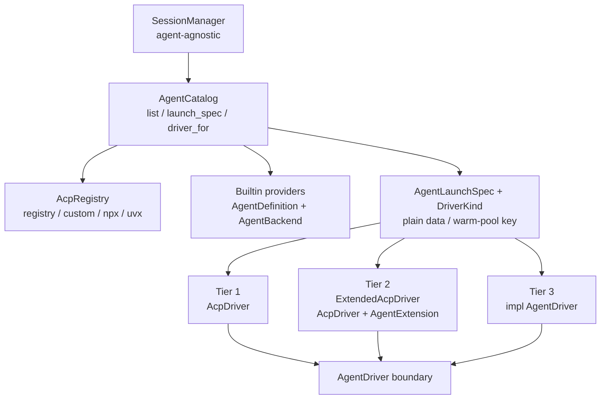
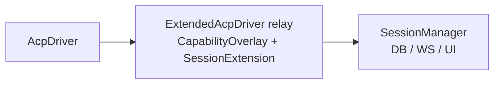

# エージェント実装の3層モデルと拡張基盤（計画）

- **日付**: 2026-11-11
- **状態**: 実装済み（Phase 1〜5 完了）
- **対象パッケージ**: `fxg-protocol`, `fxg-acp`, `fxg-node`, `fxg-cli`, `ui`,
  `docs`
- **対象スクリプト**: `mise run fmt`, `mise run lint:errors`,
  `mise run types`, `cargo test --workspace`,
  `pnpm --dir ui run check`

> 本文は実装済みのアーキテクチャです。現行仕様は
> [`docs/04-agent-drivers-and-windows.md`](../04-agent-drivers-and-windows.md) を
> 参照してください。各フェーズの実装記録は §3 のリンク先にあります。

---

## 1. 背景と目的

現在の fxg は ACP only エージェントだけを扱い、エージェント固有の事情を一切
考慮しない。ACP の範囲では、アイコン・表示名・起動オプションなどのメタデータや、
ACP に存在しない機能（独自 HTTP API によるモデル名取得、コンテキスト圧縮など）を
表現できない。

一方で、すべてのエージェントに full custom driver を要求すると、ACP が提供する
起動・イベント変換・権限・resume の実装を毎回作り直すことになる。そこで実装を
次の3層に分け、**ACP を再利用する層と、完全に自前の層を明確に分ける**。

| 層                   | 実行時の実装                           | ACP の再利用 | エージェントごとに追加するコード            |
| :------------------- | :------------------------------------- | :----------- | :------------------------------------------ |
| Tier 1: ACP only     | `AcpDriver`                            | すべて       | なし（registry / preset / custom 定義のみ） |
| Tier 2: ACP + custom | `ExtendedAcpDriver` + `AgentExtension` | すべて       | `AgentExtension` の差分のみ                 |
| Tier 3: Full custom  | `impl AgentDriver`                     | なし         | 起動・イベント変換を含む driver 実装        |

成功条件は「Tier 2 のエージェント追加が extension モジュール1個 + 登録1行で
済み、`SessionManager` / `AcpDriver` / protocol / UI に変更が不要」であること。
Tier 1 はデータのみ、Tier 3 は driver 1個の追加で完結する。

### 非目標

- 動的プラグインの ABI を今回設計しない（§2.8）
- full custom driver の実装を今回行わない
- エージェントごとの設定 UI や汎用コマンドディスパッチャを作らない
- `AgentDriver` トレイトを新しいクレートへ即時分割しない

---

## 2. 設計決定

### 2.0 決定サマリ

| ID  | 決定                                                                                                                                             |
| :-- | :----------------------------------------------------------------------------------------------------------------------------------------------- |
| D1  | エージェント実装を Tier 1 / Tier 2 / Tier 3 の3層に分ける。                                                                                      |
| D2  | エージェント固有の知識は `AgentCatalog` と extension に閉じ込める。                                                                              |
| D3  | `AgentLaunchSpec` は program / args / env / ACP options の純粋データとし、warm pool のキーにする。                                               |
| D4  | Tier 2 は**エージェント別の分岐**を `AcpDriver` に入れない。ACP の共有機能は汎用 seam として `AcpDriver` に置き、固有部分は extension に閉じる。 |
| D5  | 能力情報の上書きは自由な JSON ではなく、型付きの `CapabilityOverlay` で行う。                                                                    |
| D6  | ユーザー定義のカスタム ACP エージェントは Tier 1 のまま維持する。                                                                                |
| D7  | カスタム定義から builtin extension を参照する `extension` フィールドは Phase 4 で追加する。                                                      |
| D8  | Tier 3 の builtin ID は予約し、カスタム定義による上書きを拒否する。                                                                              |
| D9  | プラグインは将来 `AgentProvider` のアダプタとして実装し、Rust trait を ABI にしない。                                                            |
| D10 | docs と実装は同一 PR で管理し、Phase 1 から順に積み上げる。                                                                                      |

### 2.1 全体構造



`AgentCatalog` は次の3つを1箇所で解決する唯一の登録口とする。

1. **定義**: 表示名・説明・アイコンなどの `AgentDefinition`
2. **起動**: custom / preset / registry から `AgentLaunchSpec` を作る
3. **実行**: `DriverKind` から `Arc<dyn AgentDriver>` を選ぶ

`SessionManager` は `AgentCatalog` だけに依存し、agent ID による分岐を持たない。

### 2.2 型と責務

```rust
/// How an agent is implemented at runtime.
pub enum AgentBackend {
    /// ACP only (registry / preset / custom definition)
    Acp,
    /// ACP plus fxg-side extensions (tier 2)
    AcpExtended(Arc<dyn AgentExtension>),
    /// Fully custom driver (tier 3)
    Custom(Arc<dyn AgentDriver>),
}

/// Static information needed even when the agent is not running.
pub struct AgentDefinition {
    pub id: String,
    pub name: String,
    pub description: Option<String>,
    pub icon: Option<String>,
}

/// One built-in agent provider. This is the only registration seam.
pub trait AgentProvider: Send + Sync {
    fn definition(&self) -> &AgentDefinition;

    /// `None` = use the ACP Registry / custom definition launch resolution.
    fn launch_preset(&self) -> Option<&LaunchPreset> { None }

    fn backend(&self) -> &AgentBackend;
}

/// The implementation selected for a resolved launch spec.
pub enum DriverKind {
    Acp,
    AcpExtended,
    /// Full custom driver; the agent ID is in `AgentLaunchSpec.agent_id`.
    Custom,
}
```

`AgentDefinition` を `AgentDriver` から分離する。一覧表示はエージェントを起動
せずに行う必要があり、Tier 3 の driver を一覧のたびに生成したくないためである。

`AcpExtended` を `DriverKind` として明示するのも重要である。カスタム定義が
builtin の `opencode` を上書きした場合、`agent_id` だけでは「拡張を適用すべきか」
を判別できない。`launch_spec` を解決した時点で tier を確定し、factory はそれだけを
見る。

### 2.3 Tier 2 の差分 trait

```rust
/// One extension instance is shared across sessions. Keep per-session state in
/// the `SessionExtension` returned by `open_session`.
#[async_trait]
pub trait AgentExtension: Send + Sync {
    /// Display overrides (name, icon, description).
    fn metadata(&self) -> AgentMetadata { AgentMetadata::default() }

    /// Adjust launch args/env before the ACP process starts.
    /// The resulting spec is also the warm-pool key, so keep it plain data.
    fn prepare_launch(
        &self,
        _cwd: &Path,
        _launch: &mut AgentLaunchSpec,
    ) -> anyhow::Result<()> { Ok(()) }

    /// Override / augment what ACP advertises (models, modes, config options).
    /// Applied to both probe results and live CapabilitiesUpdated events.
    async fn capabilities(
        &self,
        _ctx: &SessionContext,
        _current: &CapabilitiesSnapshot,
    ) -> anyhow::Result<Option<CapabilityOverlay>> { Ok(None) }

    /// Called after the ACP session is established.
    async fn open_session(
        &self,
        _ctx: &SessionContext,
    ) -> anyhow::Result<Option<Arc<dyn SessionExtension>>> { Ok(None) }
}

#[async_trait]
pub trait SessionExtension: Send + Sync {
    async fn before_prompt(&self, _input: &mut PromptInput) -> anyhow::Result<Hook> {
        Ok(Hook::Fallback)
    }

    /// Intercept config changes if the extension provides models ACP does not know.
    async fn before_config(
        &self,
        _key: &str,
        _value: &ConfigOptionValue,
    ) -> anyhow::Result<Hook> { Ok(Hook::Fallback) }

    async fn on_event(
        &self,
        _event: DriverEvent,
    ) -> anyhow::Result<EventDisposition> {
        Ok(EventDisposition::Emit)
    }

    async fn shutdown(&self) -> anyhow::Result<()> { Ok(()) }
}

pub enum Hook { Handled, Fallback }
pub enum EventDisposition {
    Emit,
    Replace(Box<DriverEvent>),
    EmitMany(Vec<DriverEvent>),
    Drop,
}
```

能力情報の上書きは、任意のイベント書き換えではなく型付きの差分にする。

```rust
pub struct CapabilityOverlay {
    pub modes: Option<Vec<ModeInfo>>,
    pub current_mode: Option<String>,
    pub config_options: Vec<ConfigOptionPatch>,
    pub add_commands: Vec<CommandInfo>,
}

pub enum ConfigOptionPatch {
    Replace(ConfigOptionInfo),
    Merge {
        key: String,
        name: Option<String>,
        options: Option<Vec<ConfigOptionValue>>,
        current: Option<ConfigOptionValue>,
    },
    Remove { key: String },
}
```

モデル名の上書きは「`Select(id)` の値は変えず、表示名や選択肢だけを差し替える」
ことが多いため、`Merge` を基本にすると安全である。

#### 2.3.1 ACP edge hooks（サブエージェント）

ACP のサブエージェント対応では、extension が「ACP 接続の縁」に必要な情報を
提供し、`AcpDriver` が受信・順序・正規化を担う。extension に追加するのは
次の純データ / トレイトである（型の正はソース）。

- `AcpExtensionOptions`:
  - `initialize` に足す `clientCapabilities._meta`
  - 受信する独自通知の method 名
  - 有効にする `AcpCapabilitySet`（`subagents` / 将来の ACP capability）
- `AcpNotificationParser`: 独自通知の `(method, params)` を、子セッションの
  更新 (`AcpChildUpdate`) へ変換する。
- `SessionExtension` の追加フック: 生の ACP 通知の観測、子ラベル付与などの
  正規化後のイベント処理。

`AcpDriver` 側の責務は次のとおり。

- root 宛の通知と子宛の通知を分離し、子は子ごとの dynamic handler で受ける。
- 独自通知は extension が宣言した method だけを受ける
  （builder の catch-all は root の `session/update` を奪うので使わない）。
- 子の `cwd` を `SessionContexts` に登録し、fs / terminal / permission 要求を
  子のコンテキストで解決する。
- 子イベントを親と同じストリーミング結合に合流させ、`subagent_id` を付ける。

opencode の vendor 拡張は `OpenCodeExtension` に、ACP 標準の subagents RFD は
`fxg-acp` のコアに置く。これにより、将来の ACP feature 追加は Cargo feature
（`acp-all`）と `AcpCapability` の variant・mapping の追加で済み、
`AcpDriver` にエージェント名の分岐を足さない。

### 2.4 起動解決

`AgentCatalog::launch_spec` の優先順位は次のとおり。

1. `custom_agents` に ID がある → custom の起動定義
2. builtin provider がある → `launch_preset`（PATH 上に存在する場合）または
   ACP Registry の起動定義
3. ACP Registry → 既存のローカル優先解決
4. どれもなければエラー

custom が同じ ID の builtin / registry を上書きする挙動は維持する。custom 定義は
既定で Tier 1（`Acp`）とし、Tier 2 の差分を再利用したい場合だけ `extension` を
明示する（§2.6）。

Tier 2 の `prepare_launch` は、preset / registry / custom の起動定義が確定した後に
セッションの cwd とともに適用する。extension 自身が使う資格情報はエージェントの
env に混ぜず、node の secret store から読む。custom 定義 + extension の組み合わせは
実装済みである。

### 2.5 Tier 2 のイベント合成



`ExtendedAcpDriver` は `AcpDriver` のイベントチャネルを中継し、次の順で処理する。

1. `CapabilitiesUpdated` に `CapabilityOverlay` を適用する
2. `SessionExtension::on_event` に通す
3. 下流の `SessionManager` へ送る

実装上の注意:

- `start_session` の内部で `CapabilitiesUpdated` が送られるため、relay 開始までは
  イベントをバッファする
- `open_session` に ACP セッション ID を渡すため、`StartedSession` に
  `agent_session_id: Option<String>` を追加する（またはバッファ内の
  `SessionAgentBound` を拾う）
- extension の失敗でセッションを落とさない。overlay 失敗時は元の ACP イベントを
  そのまま流し、`warn!` に留める
- overlay は `session/new` 後だけでなく、その後の `CapabilitiesUpdated` にも
  毎回適用する
- 通常セッションと capability probe の両方が同じ relay を通るため、`probe.rs` に
  エージェント固有の処理を追加しない

### 2.6 カスタム ACP 定義の扱い

`CustomAgentConfig` は起動定義であり、`AgentBackend` を選ぶものではない。現行の
`name` / `command` / `args` / `env` / `env_secrets` はそのまま維持する。

| 定義                     | backend       | 起動方法                           |
| :----------------------- | :------------ | :--------------------------------- |
| custom（extension なし） | `Acp`         | ユーザーの command / args / env    |
| custom + extension 参照  | `AcpExtended` | custom の起動 + 組み込み extension |
| builtin Tier 1           | `Acp`         | preset / registry                  |
| builtin Tier 2           | `AcpExtended` | preset / registry + extension      |
| builtin Tier 3           | `Custom`      | driver 自身                        |

Tier 2 の拡張をユーザー定義でも使えるよう、次を追加した。

```rust
pub struct CustomAgentConfig {
    pub name: Option<String>,
    pub command: String,
    pub args: Vec<String>,
    pub env: BTreeMap<String, String>,
    pub env_secrets: BTreeMap<String, SecretId>,

    /// Built-in extension ID to apply on top of this custom launch.
    /// None = ACP only.
    pub extension: Option<String>,
}
```

- `node.db` の `custom_agents` に `extension TEXT` を追加した
  （migration `0016_custom_agent_extension.sql`）
- `UpsertCustom` 時に extension ID の存在を検証し、未知なら保存を拒否する
- 起動時にも再検証し、extension が消えていたら明確なエラーを返す
- メタデータの優先順位は `custom.name` → `extension.metadata` → ID
- custom が builtin Tier 2 を上書きし、かつ `extension` 未指定の場合は Tier 1 に
  なる。UI の extension 選択で builtin extension を明示できる
- custom が builtin Tier 3 の ID を使うことは拒否する（D8）

### 2.7 Tier 3

`AgentProvider` が `AgentBackend::Custom(Arc<dyn AgentDriver>)` を返す経路を
追加する。driver インスタンスは provider が所有し、catalog の `driver_for` が
clone して返す。セッション間で共有される。

- `DriverKind::Custom` は `agent_id` から provider の driver を解決する
- capability probe は既存の driver 非依存な実装をそのまま使う
- `shutdown_idle` / `stderr_tail` / `stderr_snapshot` は既存のデフォルト実装を
  利用できる
- `AgentLaunchSpec.program` は `Option<PathBuf>` とし、ローカルプロセスを起動
  しない driver は `None` を受け取れる。ACP は `Some` を必須とする
- full custom driver は起動・イベント変換・エラー処理の契約を
  `AgentDriver` の doc コメントに明記する
- Tier 3 provider の一覧エントリは「ドライバが組み込まれている」ため、
  `sources` が空でも利用可能として扱う

### 2.8 プラグイン将来像

`AgentProvider` を唯一の登録口にしておけば、プラグイン対応時も `AgentCatalog`
以下は変えずに済む。ただし、`AgentExtension` / `AgentDriver` をそのまま動的
ライブラリの ABI にはしない。Rust の trait object は ABI 安定ではないため、
将来は次の二段構えにする。

- プラグイン側: バージョン付き manifest + JSON Lines / IPC / WASM のプロトコル
- fxg 側: そのプロトコルを `AgentProvider` / `AgentDriver` に適合させるアダプタ

今回の trait は「プロセス内の実装 seam」として割り切り、`AgentProvider` の
メソッドをデータ寄り・粗めに保つ。`fxg-acp` に置くのは、`agent-client-protocol`
に依存しない形にしておけば後の `git mv` で切り出せるためである。

### 2.9 プロトコル / UI

`AgentSummary` に次を追加する。

```rust
pub enum AgentBackendKind {
    Acp,
    AcpExtended,
    Custom,
}

pub struct AgentSummary {
    // existing fields ...
    pub backend: AgentBackendKind,
    pub icon: Option<String>,
}
```

- UI はエージェント一覧とセッション作成画面に backend バッジを表示する
- アイコンは URL または builtin のアセットキーとして扱い、UI 側で解決する
- Tier 2 のモデル名上書きは既存の `CapabilitiesUpdated` / `config_options` に
  乗るため、新しい UI は不要
- `mise run types` で `ui/src/lib/generated/bindings.ts` を同期する
- `AgentSummary.backend` により、custom 定義が Tier 1 であることも UI で判別できる

---

## 3. 実装フェーズ

### Phase 1: `AgentCatalog` とメタデータ（挙動変更なし）

- [x] `crates/fxg-acp/src/agent/{mod,catalog,provider}.rs` を追加する
- [x] `AGENT_PRESETS` を builtin provider に移す
- [x] `AgentLaunchSpec` / `DriverKind` は `Acp` のみのまま
- [x] `AgentListEntry` に `backend` / `icon` を追加する
- [x] `AgentSummary` に `backend` / `icon` を追加し、bindings を更新する
- [x] `SessionManager` の `AcpRegistry` + `DriverFactory` を `AgentCatalog` に置き換える
- [x] 解決順位・custom の優先・driver 選択の単体テストを追加する

完了条件: 既存の ACP only エージェントの挙動が変わらず、全テストが通る。

実装ログ: 2026-11-11 に完了。詳細は
[`2026-11-11-agent-catalog-phase1.md`](./2026-11-11-agent-catalog-phase1.md) を参照。

### Phase 2: Tier 2 の基盤

- [x] `AgentExtension` / `SessionExtension` / `CapabilityOverlay` を追加する
- [x] `ExtendedAcpDriver` とイベント relay を実装する
- [x] `DriverKind::AcpExtended` を追加する
- [x] `StartedSession.agent_session_id` を追加する
- [x] mock extension でモデル追加・表示名変更を検証する
- [x] capability probe が上書き結果を返すことを検証する
- [x] extension 失敗時に元のイベントが流れることを検証する

完了条件: 実 ACP エージェントを変更せず、probe と通常セッションの両方で
overlay が効く。

実装ログ: 2026-11-11 に完了。詳細は
[`2026-11-11-agent-extension-phase2.md`](./2026-11-11-agent-extension-phase2.md) を参照。

### Phase 3: Tier 3 の基盤

- [x] `DriverKind::Custom` を追加する
- [x] provider から `Arc<dyn AgentDriver>` を返す経路を追加する
- [x] mock full custom driver を `SessionManager` 経由で起動する統合テストを追加する
- [x] `AgentLaunchSpec.program` の `Option` 化を判断・実装する
- [x] full custom driver の契約を doc コメントに明記する

完了条件: ACP に依存しない driver が一覧・起動・probe・shutdown まで通る。

実装ログ: 2026-11-11 に完了。詳細は
[`2026-11-11-agent-extension-phase3.md`](./2026-11-11-agent-extension-phase3.md) を参照。

### Phase 4: 最初の実例（opencode）

- [x] `opencode` を Tier 2 に移行する
- [x] メタデータ（表示名・アイコン）とモデル名の上書きを実装する
- [x] `CustomAgentConfig.extension` と DB migration を追加する
- [x] カスタム定義 + builtin extension の組み合わせを検証する
- [x] 追加が extension モジュール1個 + 登録1行で済むことを確認する
- [x] 必要なら `SessionExtension` の最初の実機能（compact など）を追加する
      （今回は ACP が compact を提供するため追加せず）

完了条件: ユーザー定義の ACP エージェントでも、コードを書かずに Tier 2 の
モデル名上書きを再利用できる。

実装ログ: 2026-11-11 に完了。詳細は
[`2026-11-11-agent-extension-phase4.md`](./2026-11-11-agent-extension-phase4.md) を参照。
実 opencode（v2.2.7）で probe・セッション起動・モデル変更まで確認済み。

### Phase 5: ドキュメント

- [x] `docs/04-agent-drivers-and-windows.md` の §1.1 を実装内容に合わせて更新する
- [x] このファイルの状態を「実装済み」に変更し、実装ログを追記する
- [x] `AGENTS.md` の構成説明に `AgentCatalog` / extension を追記する

実装ログ: 2026-11-11 に完了。`docs/04` §1.1 / §3、`docs/README.md`、
`AGENTS.md` を実装済みの内容に更新した。各フェーズの詳細は
[`2026-11-11-agent-catalog-phase1.md`](./2026-11-11-agent-catalog-phase1.md)、
[`2026-11-11-agent-extension-phase2.md`](./2026-11-11-agent-extension-phase2.md)、
[`2026-11-11-agent-extension-phase3.md`](./2026-11-11-agent-extension-phase3.md)、
[`2026-11-11-agent-extension-phase4.md`](./2026-11-11-agent-extension-phase4.md)
を参照。

---

## 4. 変更対象

| ファイル                                                   | 変更内容                                                     |
| :--------------------------------------------------------- | :----------------------------------------------------------- |
| `crates/fxg-acp/src/agent/mod.rs`                          | `AgentDefinition` / `AgentProvider` / `AgentBackend`         |
| `crates/fxg-acp/src/agent/catalog.rs`                      | `AgentCatalog`（list / launch_spec / driver_for）            |
| `crates/fxg-acp/src/agent/extension.rs`                    | `AgentExtension` / `SessionExtension` / `CapabilityOverlay`  |
| `crates/fxg-acp/src/agent/builtin.rs`                      | builtin provider の登録（opencode は Tier 2）                |
| `crates/fxg-acp/src/driver.rs`                             | `DriverKind` の3値化、`StartedSession.agent_session_id`      |
| `crates/fxg-acp/src/registry.rs`                           | 一覧生成の catalog 移設、`AgentListEntry.backend` / `icon`   |
| `crates/fxg-node/src/session_manager/mod.rs`               | `AcpRegistry` + `DriverFactory` を `AgentCatalog` に置き換え |
| `crates/fxg-node/src/daemon/ops.rs`                        | `AgentSummary.backend` / `icon` の設定                       |
| `crates/fxg-cli/src/commands/agents.rs`                    | login も `AgentCatalog` 経由にして `prepare_launch` を適用   |
| `crates/fxg-protocol/src/client_api.rs`                    | `AgentBackendKind`、`AgentSummary.backend` / `icon`          |
| `crates/fxg-acp/src/agent/opencode.rs`                     | OpenCode extension（metadata / model labels）                |
| `crates/fxg-protocol/src/settings.rs`                      | `CustomAgentConfig.extension`                                |
| `crates/fxg-db/migrations/0016_custom_agent_extension.sql` | `custom_agents.extension`                                    |
| `ui/src/lib/components/settings/AgentManager.svelte`       | カスタム定義の extension 選択                                |
| `ui/src/lib/generated/bindings.ts`                         | `mise run types` で再生成                                    |
| `ui/messages/en.json`                                      | extension 選択の文言                                         |

---

## 5. テスト計画

### 単体テスト

- `CapabilityOverlay` の `Replace` / `Merge` / `Remove` が期待どおり適用される
- 解決順位が custom → builtin provider → registry になる
- custom が Tier 2 builtin を上書きした場合に `DriverKind::Acp` になる
- custom + extension が `DriverKind::AcpExtended` になる
- 未知の extension ID が保存・起動時に拒否される
- Tier 3 の予約 ID を custom で上書きできない
- `DriverKind` から正しい driver が選ばれる（Tier 1 / 2 / 3）

### 統合テスト

- mock ACP agent + fake `AgentExtension` で probe のモデル一覧が上書きされる
- 通常セッションの `CapabilitiesUpdated` が同じ overlay で上書きされる
- extension のエラーがセッション失敗にならない
- mock full custom driver が `SessionManager` から起動・停止できる
- 既存の ACP only セッション（resume / fork / permission）が回帰しない

### UI

- エージェント一覧とセッション作成画面に backend バッジが表示される
- Tier 2 のモデル名が設定画面とセッション作成画面に反映される
- Phase 4 の custom 編集で extension を選択でき、未知 ID は保存できない

---

## 6. 実装時に確定した点

- `opencode` の extension はメタデータ + モデル名の上書きに限定した。compact
  などのセッションフックは、ACP が同等機能を提供しているため今回は追加して
  いない。
- アイコンの表現は URL または builtin アセットキー（`builtin:opencode`）の
  `String` とした。ダークテーマ用の別アイコンが必要になった時点で型を拡張する。
- `AgentDriver` のクレート分割は、Tier 3 の実例が増えて `fxg-acp` が
  ACP SDK に依存しない形を保てなくなった時点で行う。
- `AgentLaunchSpec.program` は Phase 3 で `Option<PathBuf>` とし、プロセスを
  持たない Tier 3 driver を表現できるようにした。
- `CapabilityOverlay` は `CapabilitiesUpdated` ごとに現在値から再計算する。
  1回だけ計算すると、モデル変更後の `Replace` が古い値へ巻き戻すため。

---

## 7. 関連ドキュメント

- [`docs/04-agent-drivers-and-windows.md`](../04-agent-drivers-and-windows.md) §1.1
- [`docs/03-protocol-and-api.md`](../03-protocol-and-api.md)（`AgentSummary` の
  変更は実装時に反映）
- [`docs/06-type-safety.md`](../06-type-safety.md)（`DriverKind` /
  `CapabilityOverlay` は open enum と型付き差分を使う）
- [`2026-11-11-registry-import.md`](./2026-11-11-registry-import.md)（Registry を
  import 専用にした後続変更）
